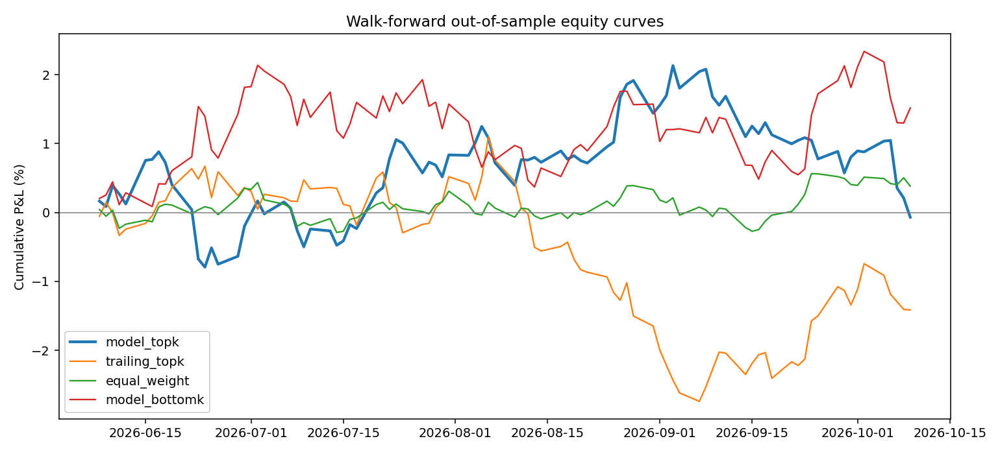
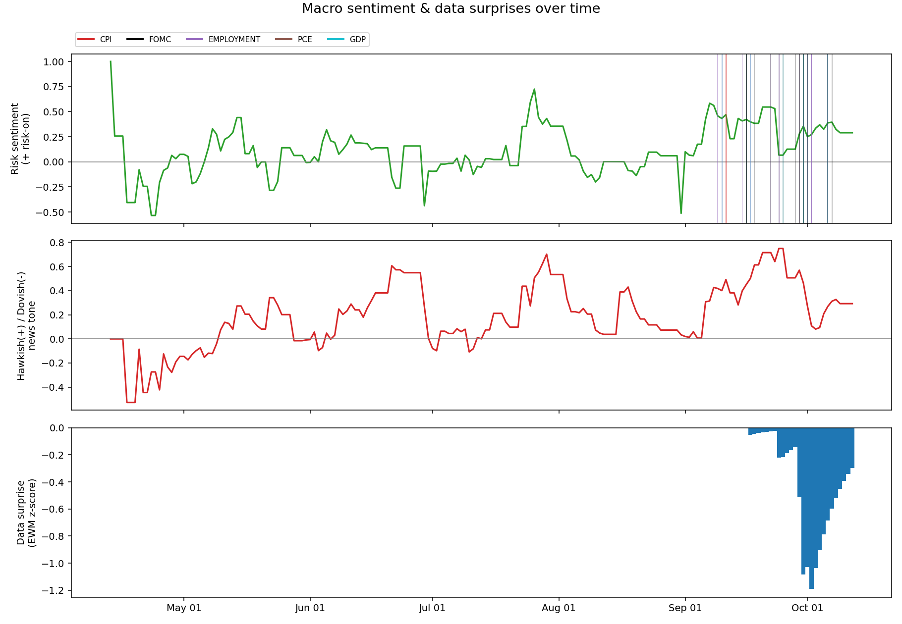
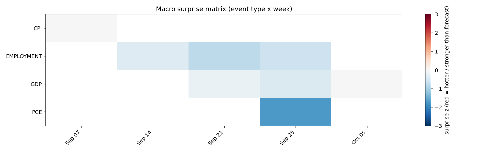
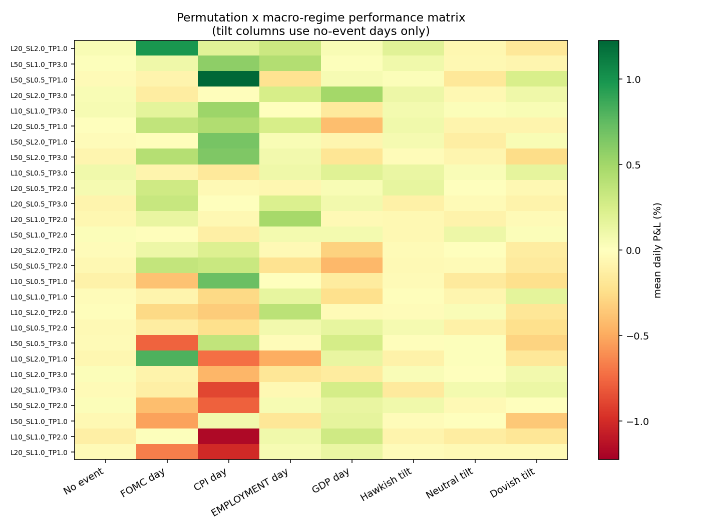

# Evaluation Report - Walk-Forward Strategy Permutation Model

> **PROXY EVALUATION — SYNTHETIC P&L, NOT REAL TRADES.** Calendar events and news are loaded from the collected source exports, but every trading outcome is randomly generated with zero-mean noise and no planted predictive relationship. Sharpe, Sortino, drawdown, forecast scores and rankings are software-test outputs only; they are not evidence of profitability.

## 1. Setup
- Model: `hgb`  |  Features: 41  |  Permutations: 27  |  Trades: 3510
- Target: next-day P&L (% of allocated capital) of each (day, permutation) row
- Validation: expanding-window walk-forward, min train 40 days, test block 5 days,
  embargo 1 day, **18 folds**, out-of-sample span 2026-06-08 -> 2026-10-09 (90 days)
- Selection rule: each day hold the top-5 permutations by predicted P&L, equal weight
- Leakage controls: realised data lagged 1 day; only scheduled calendar info unlagged; model never refit on test rows
- No transaction costs, slippage or capacity limits are modelled.

## 2. Strategy performance (out-of-sample)
|  | n_days | total_pnl_% | mean_daily_% | ann_vol_% | sharpe | sortino | max_drawdown | hit_rate |
|---|---|---|---|---|---|---|---|---|
| model_topk | 90.000 | -0.070 | -0.001 | 4.204 | -0.046 | -0.064 | -0.022 | 0.511 |
| trailing_topk | 90.000 | -1.415 | -0.016 | 3.943 | -1.005 | -1.414 | -0.038 | 0.433 |
| equal_weight | 90.000 | 0.381 | 0.004 | 1.885 | 0.565 | 0.808 | -0.007 | 0.478 |
| model_bottomk | 90.000 | 1.516 | 0.017 | 4.617 | 0.919 | 1.352 | -0.017 | 0.522 |

Sharpe / Sortino annualised with sqrt(252); max drawdown is relative to peak equity (start = 100).
**Any apparent ranking/performance differences are artifacts of synthetic outcomes and must not be interpreted as evidence of predictive skill.**

## 3. Forecast quality (out-of-sample)
|  | value |
|---|---|
| n_predictions | 2430.0000 |
| rmse | 0.6143 |
| mae | 0.4896 |
| r2 | -0.0404 |
| mean_rank_ic | -0.0005 |
| ic_ir | -0.0028 |
| ic_positive_days | 0.5222 |
| direction_accuracy | 0.5037 |

`mean_rank_ic` is the average daily cross-sectional Spearman correlation between predicted and realised P&L; it is the
metric that matters for a ranking/selection use-case. R2 is typically near zero for noisy P&L and should not be over-read.

## 4. Feature importance (permutation, last 4 folds)
|  | importance | std |
|---|---|---|
| vol_pnl_5 | 0.01350 | 0.00353 |
| ret_lag1 | 0.01146 | 0.00184 |
| vol_pnl_20 | 0.01139 | 0.00108 |
| mean_pnl_5 | 0.00852 | 0.00235 |
| day_of_month | 0.00733 | 0.00182 |
| mean_pnl_20 | 0.00608 | 0.00103 |
| sent_change_5d | 0.00489 | 0.00091 |
| mkt_mean_pnl_5 | 0.00460 | 0.00086 |
| dow_cos | 0.00459 | 0.00113 |
| hawk_dove_ewm | 0.00314 | 0.00068 |

## 5. Synthetic proxy rankings (not trading recommendations)
| permutation_id | date | lookback | stop_loss | take_profit | pred_pnl_% |
|---|---|---|---|---|---|
| L20_SL1.0_TP2.0 | 2026-10-12 00:00:00 | 20 | 1.000 | 2.000 | 0.081 |
| L50_SL0.5_TP1.0 | 2026-10-12 00:00:00 | 50 | 0.500 | 1.000 | 0.069 |
| L50_SL1.0_TP2.0 | 2026-10-12 00:00:00 | 50 | 1.000 | 2.000 | 0.054 |
| L20_SL1.0_TP3.0 | 2026-10-12 00:00:00 | 20 | 1.000 | 3.000 | 0.047 |
| L20_SL0.5_TP3.0 | 2026-10-12 00:00:00 | 20 | 0.500 | 3.000 | 0.040 |

## 6. Macro visuals

## 7. Caveats
- Few macro releases fit in 180 days (about 6 CPI, 6 jobs, 4 FOMC); event-specific conclusions have wide error bars.
- Sentiment uses a keyword lexicon; upgrade to a finance-tuned classifier for production.
- Top-k selection from many permutations carries multiple-testing risk; confirm on a longer, untouched hold-out.
